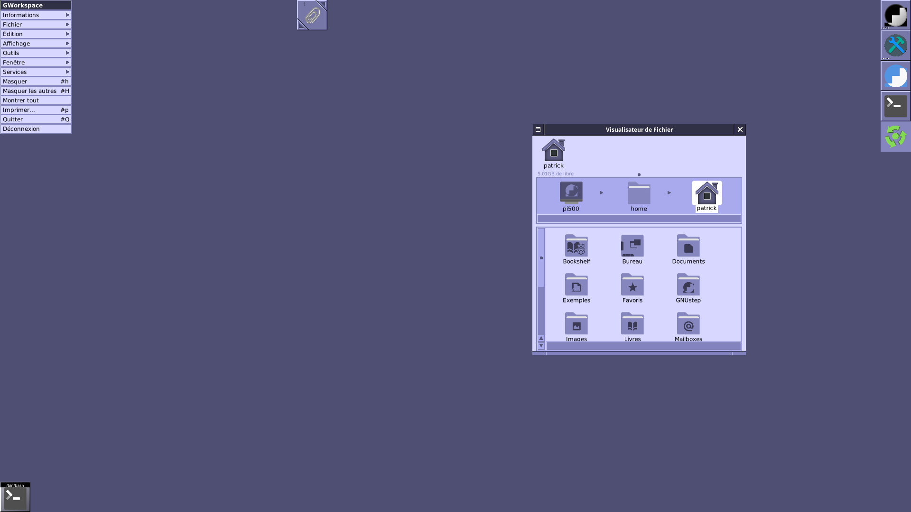

# agnostep-theme

GNUstep theme installer for the [AGNoStep Desktop Project](../../../agnostep-desktop).

Although this theme installer was created with the AGNoStep Desktop Project   
in mind, it could be also used with any other GNUstep system already   
installed with a few tweaks. If you did, let me know.
 
- Read [RELEASE](Documentation/RELEASE.md) to know the current status.
- See [CHANGES](Documentation/CHANGES.md) to read the details of the latest changes.

## Provided themes

### AGNOSTEP

- This theme was created mostly from the [Papirus Iconset](https://github.com/PapirusDevelopmentTeam/papirus-icon-theme.git).
New icons were also created for most applications.
- The UI theme was inspired by the Sleek flat theme of GNUstep.
- The color space (palette) was inspired from the classic OPENSTEP background. See details in the [AGNOSTEP_ART](AGNOSTEP_ART) folder.
- AGNOSTEP-theme is under the [MIT License](LICENSE) as its main repo.

#### Screenshot

Below, AGNoStep-desktop with AGNOSTEP theme applied.



### Other themes

- GNUstep default theme: this is the default theme on which you can revert.
- Rik: a modern theme inspired by MacOS.

## Installing agnostep-theme and setting a theme

1. Logout your graphical session.
2. Log in a TTY session,`Ctrl+Alt+F2`,  then:

```console
cd SOURCES
git clone https://github.com/pcardona34/agnostep-theme.git
cd agnostep-theme/install
bash ./theming
```
- Then choose the theme to apply.
- Log in again in the graphical session and enjoy the new applied theme.

## FAQ

- How to set a background? Install [agnostep-wall](../../../agnostep-wall).
